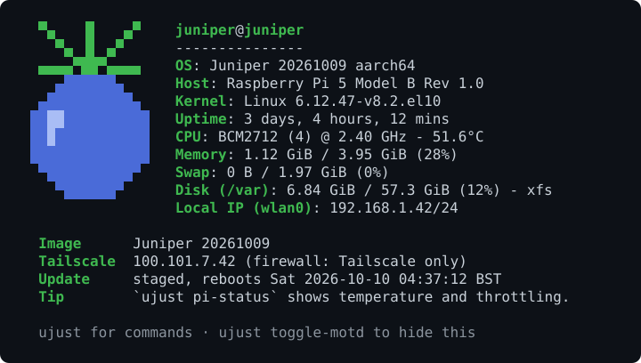

# Juniper

[](https://github.com/gnathoi/juniper/actions/workflows/build.yml)
[](https://github.com/gnathoi/juniper/releases/latest)
[](LICENSE)
[](system_files/usr/share/pki/containers/juniper.pub)

[](https://github.com/AlmaLinux/bootc-images-rpi)

Opinionated [bootc](https://bootc-dev.github.io/bootc/) images for Raspberry Pi 4/5 (incl.
400/500, CM4/CM5), layered on the [AlmaLinux RPi bootc image](https://github.com/AlmaLinux/bootc-images-rpi) in the spirit of Bluefin and
Bazzite.



A Pi 5 running `juniper`. `juniper-minimal` shows just the status block.

| | `juniper-minimal` | `juniper` |
|---|---|---|
| Purpose | appliance base | dev box |
| Tailscale, flash-time join, firewall lockdown, `ujust lan-ssh` | yes | yes |
| Podman + quadlets, nightly `podman auto-update`, firewalld | yes | yes |
| cloud-init first boot, secrets scrubbed from the boot partition | yes | yes |
| Signed weekly updates, reboot window, firmware tryboot fallback | yes | yes |
| zram, journald cap, hardware watchdog, `noatime` | yes | yes |
| `ujust` core: update, update-schedule, lan-ssh, tailscale-*, pi-status, enable-metrics | yes | yes |
| Login status (Tailscale, update state) | yes | yes |
| Juniper logo + system summary at login | no | yes |
| Homebrew, distrobox, git; zellij, neovim, btop, ripgrep, fzf via a Brewfile | no | yes |
| `ujust devbox`, `ujust install-podlet` | no | yes |

## Images

Dev box (minimal + developer tools):

```
ghcr.io/gnathoi/juniper:latest
```

Appliance base, to build `FROM`:

```
ghcr.io/gnathoi/juniper-minimal:latest
```

Every image, disk image and checksum is cosign-signed, and Pis only accept signed OS
updates (required for everything under `ghcr.io/gnathoi`). Verify with:

```
cosign verify --key system_files/usr/share/pki/containers/juniper.pub ghcr.io/gnathoi/juniper:latest
```

## Install

1. Create a **tagged**, one-off, pre-approved auth key at
   <https://login.tailscale.com/admin/settings/keys>. Tagged devices never expire, so the
   lockdown can't lock you out later. The key turns on Tailscale SSH, so add an `ssh` rule to
   your tailnet policy that lets you in to that tag, e.g.
   `{"action": "accept", "src": ["autogroup:member"], "dst": ["tag:server"], "users": ["autogroup:nonroot", "root"]}`.
2. Flash an SD card or USB disk: with `just flash` on Linux (below), or by hand on any OS.
3. Boot. The Pi joins your tailnet; `ssh <user>@<hostname>` over Tailscale.

### Flash with `just flash` (Linux only, for now)

From a clone of this repo. Needs `just`, `cosign`, `curl`, `jq`, `xz`, Python 3 with PyYAML,
and `run0` or `sudo` for the write.

    install -Dm600 examples/flash.yaml ~/.config/juniper/flash.yaml   # fill it in
    just flash /dev/sdX ~/.config/juniper/flash.yaml

The config ([`examples/flash.yaml`](examples/flash.yaml)) holds the image (`juniper` or
`juniper-minimal`), hostname, user, SSH keys, timezone, Tailscale key and Wi-Fi. `just flash`
downloads the latest release (or pass a tag or a local `.raw.xz` as a third argument),
checks its cosign signature, refuses anything but a removable, USB or SD card disk, shows
what it will write and asks for a y/N before erasing it.

### Flash by hand (any OS)

Download `juniper-*.raw.xz` or `juniper-minimal-*.raw.xz` and its `.bundle` from
[Releases](https://github.com/gnathoi/juniper/releases), verify it, and flash it with any
tool:

    cosign verify-blob --key system_files/usr/share/pki/containers/juniper.pub \
      --bundle juniper-YYYYMMDD.raw.xz.bundle juniper-YYYYMMDD.raw.xz

Then edit `user-data` on the small FAT partition and, for Wi-Fi, add `network-config` (see
`README.txt` there).

## On the Pi

Run `ujust` to list Juniper's commands (updates, reboot window, LAN SSH escape hatch,
Tailscale, metrics, Pi status, and on `juniper` the dev box).

The `juniper` image's Homebrew comes from Bluefin's `ublue-os/brew` and updates and
upgrades your brew packages automatically (`brew-update.timer`, `brew-upgrade.timer`).

## Build your own appliance

See [examples/appliance](examples/appliance): `FROM ghcr.io/gnathoi/juniper-minimal`, add
packages and quadlets, push, `bootc switch` the device to it.

## Switch an existing AlmaLinux RPi bootc system

The first switch is trust-on-first-use: the starting system doesn't check Juniper's signature
yet. So verify the image with [`juniper.pub`](system_files/usr/share/pki/containers/juniper.pub)
(this repo) and switch to exactly the digest that was verified, not the tag, which could
move in between:

    digest=$(cosign verify --key juniper.pub ghcr.io/gnathoi/juniper:latest \
      | jq -r '.[0].critical.image."docker-manifest-digest"')
    sudo bootc switch "ghcr.io/gnathoi/juniper@$digest"
    sudo reboot

That boot is pinned to the digest and would never update. Once it runs Juniper, whose policy
checks the signature on every pull, point it back at the tag:

    ujust switch ghcr.io/gnathoi/juniper:latest

On a Juniper device, `ujust switch IMAGE` switches and reboots in one step. A plain reboot
keeps the current image; use `ujust switch`/`ujust update`.

## Build

    just check                                   # lint + unit tests
    just image=juniper-minimal build             # arm64 (arm64 host or qemu-user-static)
    just image=juniper-minimal test-image
    just bump-brew                               # move the Homebrew pin (verifies signature)
    sudo just build-raw ghcr.io/gnathoi/juniper:latest

## Release schedule

A new release (both signed images, disk images and release notes) is published every
Monday at 02:00 UTC with that week's dependency and security updates. Pis download it daily
and reboot into it on Tuesday at 04:00 local time, within a 90-minute window; change that
with `ujust update-schedule`, or apply it now with `ujust update`.

## Acknowledgements

Juniper stands on other people's work:

- [AlmaLinux's bootc images for Raspberry Pi](https://github.com/AlmaLinux/bootc-images-rpi),
  the base image, and [bootc](https://github.com/bootc-dev/bootc) itself.
- [rpi-bootc-bootloader](https://github.com/kfox1111/rpi-bootc-bootloader), which makes Pi
  firmware tryboot and rollback work with bootc.
- [Universal Blue](https://universal-blue.org)'s [Bluefin](https://github.com/ublue-os/bluefin)
  and [Bazzite](https://github.com/ublue-os/bazzite), where the overall approach and `ujust`
  come from, and [ublue-os/brew](https://github.com/ublue-os/brew) for Homebrew on bootc.
- [Zirconium](https://github.com/zirconium-dev/zirconium), whose niri setup informs the planned
  desktop image.

To cite Juniper, use GitHub's "Cite this repository" (from [CITATION.cff](CITATION.cff)).

## License

Apache-2.0. See [THIRD_PARTY.md](THIRD_PARTY.md) for bundled components and where to get
their source.

Raspberry Pi is a trademark of Raspberry Pi Ltd. AlmaLinux is a trademark of the AlmaLinux
OS Foundation. Juniper is an independent project, not affiliated with or endorsed by either.
