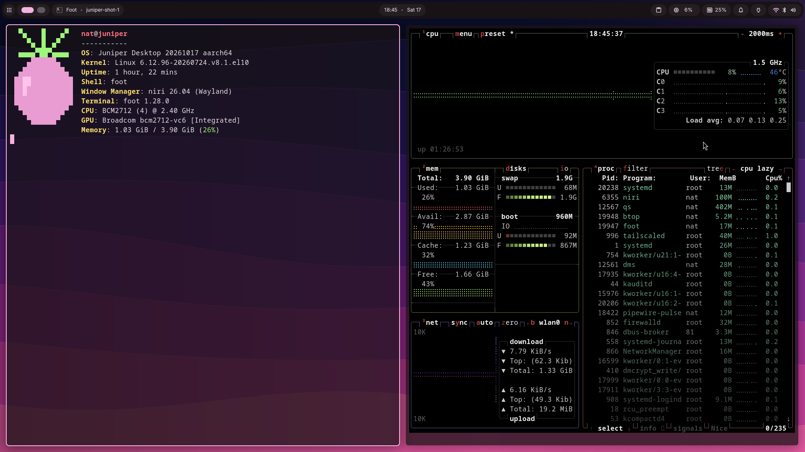

# The desktop: `juniper-desktop`

`juniper` plus a desktop: niri with DankMaterialShell, Firefox and the Bazaar app store from
Flathub. It is built, tested in CI and published (signed image and disk image), and was
tested on a Raspberry Pi 5 (4 GB) on 2026-10-17 ([acceptance](acceptance.md)). It isn't in
Raspberry Pi Imager's list yet.

## Logging in

It boots to DankMaterialShell's graphical login (dms-greeter, running as the unprivileged
`greeter` user); your niri session starts only after you log in with your password, never
automatically. `just flash` and `ujust switch` both require a password for the first user
(uid 1000), and on a flashed desktop `sudo` asks for it too. A user with no picture gets
Juniper's (the terminal's berry logo) at their first login; change it in DMS's settings
window, and Juniper won't set it again.

## Using it

The desktop is niri with DankMaterialShell: bar, launcher, notifications, clipboard history,
lock screen and a settings window, coloured from Juniper's wallpaper. The keys are
zirconium's, and the key list comes up at each login:

| Key | Does |
| --- | --- |
| Mod+/ | show every key |
| Mod+T or Mod+Return | terminal (foot) |
| Mod+Space | launcher |
| Mod+N | notifications |
| Mod+Alt+V | clipboard history |
| Mod+Alt+L | lock the screen |
| Mod+Ctrl+arrows | move windows |
| Mod+1 … Mod+9, Mod+O | workspaces, overview |
| Mod+V | toggle floating |

DankMaterialShell's weather and location lookups are off, geoclue never asks an online
service where the device is (its IP and Wi-Fi sources are off in
`/etc/geoclue/conf.d/90-juniper.conf`), and DMS's update button runs `ujust update`, so
updates still go through Juniper's health-checked path.

## Your settings

- Your niri changes go in `~/.config/niri/local.kdl`; DMS's settings window writes its own.
  Juniper refreshes the rest of its dotfiles daily unless you changed them
  (`ujust toggle-auto-dots` turns that off); `ujust dots-reset niri|all` puts Juniper's back
  (yours go to a backup in `~/.local/state/juniper`). A dotfile that already existed before
  Juniper's first apply is kept and listed in `~/.local/state/juniper/dots-kept`; it gets no
  updates until you reset it. `niri` resets only `config.kdl` and `dms.kdl`, `all`
  everything.
- `ujust desktop-lock-idle on|off` turns the lock after 10 minutes idle on or off.
- `ujust flatpak-setup` retries the first-boot install of Firefox and Bazaar.

## Updates on a desktop

A pending update's reboot waits while the desktop is in use (not idle for 30 minutes), for at
most 7 days after the first deferral. A deferred update is retried hourly and applies once
the desktop is idle, which can be outside the reboot window; a notification says so, with the
deadline. `ujust update-schedule off` turns these reboots off too. Under tryboot the update
also needs greetd to be running, or it falls back (the health check doesn't yet check that a
session can start: #58).
